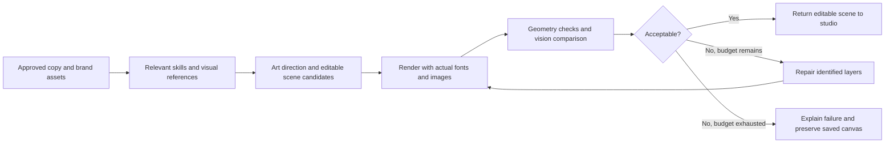

# AI design research and implementation recommendation

Research date: 12 October 2026. Scope: improve generated campaign visuals while preserving the existing editable canvas. Findings below distinguish source inspection, documented platform capabilities, and proposed work. No live generation benchmark or provider-failure reproduction was performed.

## Diagnosis from this repository

There are two different design paths, and improving only the AI design button will leave initial campaign designs unchanged.

| Path | Current behavior | Consequence |
| --- | --- | --- |
| Campaign generation V2 | `src/lib/server/generation-v2/index.ts:197` calls `campaignDesignPlanToCanvas` after reviewing the campaign plan. | Initial canvas is assembled by deterministic geometry rather than the freeform AI canvas designer. |
| V2 canvas assembly | `src/lib/generation-v2/design-canvas.ts:55` defines fixed vertical zones; every text block starts at x=8 with width=84. CTA sits at y=84. Screenshot occupies a fixed lower strip. | Different concepts converge on the same composition. `layoutVariant` and `emphasis` do not affect this renderer. |
| Manual AI design | `src/lib/server/campaign-generator.ts:1846` requests one structured scene and validates it. | Model can choose geometry, but never sees the rendered result or receives visual repair feedback. |
| Fonts | `designFontOptions`, request data, prompt, parser, and V2 renderer enforce Outfit. | Brand typography is replaced even when brand font information exists. Changing one prompt alone cannot remove this restriction. |
| Visual evidence | `loadDesignVisualInputs` fetches only HTTP(S) images, accepts JPEG/PNG/WebP, silently skips errors, and returns at most three images. | Local `/api/assets/...` uploads and local images can be listed as assets without their pixels reaching the model. Logos may lose priority to product images. SVG references are skipped. |
| Validation | Manual parser checks schema, theme contrast, text safe areas, approved wording, and asset references. | Valid JSON can still contain weak hierarchy, unreadable per-layer contrast, clipped text, collisions, or an empty-looking composition. |
| Reliability | Manual design sets SDK retries to zero; chat path disables malformed-response and transient retries. Route converts the wrapped failure to a generic 502. | Provider problems and invalid generated designs become hard to distinguish in the UI. Underlying error is logged server-side. |

The supplied screenshot strongly resembles V2's fixed geometry: short top rule, centered copy, large unused middle, and full-width bottom CTA. This is evidence of a plausible source, not proof of the saved campaign's generation provenance. The screenshot shows a failed redesign and the preserved existing canvas; it does not establish that the failed request generated the visible design.

The exact 502 cause remains unknown without its server log/request trace. Provider capability mismatch, timeout, quota, malformed output, and validation failure need separate diagnosis. Do not label this an outage without evidence.

## Adding skills to the application AI

### Follow-up: pasted studio specification

The supplied JSON reveals a third source of fixed geometry: `src/lib/studio/editor-state.ts`. Its text coordinates and sizes match `TEXT_ELEMENT_DEFAULTS`; panel `(53,14,42,64,-3)`, image `(57,17,36,58)`, lower rule, rocket placement, and animation settings match `createRichSingleImageElements` and `iconElement`. This is strong evidence of default editor scaffolding, although saved or generated layers could also copy those values.

`getEditorElements` returns supplied layers when present and otherwise calls `createDefaultEditorElements`. A `custom` composition receives the generic single-image branch; the label does not guarantee independently designed geometry. This fallback must be included when implementing the shared scene workflow. Manual insertion defaults can remain useful, but missing generated layers should not masquerade as a finished AI design.

Concrete weaknesses visible in this specification:

- Empty body/footer layers persist despite having no content.
- A tall screenshot slot and tilted backing panel are chosen without evidence that this aspect ratio suits the source image.
- A rocket, glow, pulse, and floating image are inserted as defaults rather than justified by the campaign concept.
- CTA explicitly uses accent-colored text and has no fill. The current text renderer supplies foreground as its background: the result is red text on a near-black button rather than the intended accent-filled treatment. Per-layer contrast needs checking against the actual rendered background.
- Text sizes use canvas-width units, while positions and box sizes use percentages. The Spec display does not explain those units, making independent interpretation ambiguous.

The Spec tab in `src/components/studio/mini-canva-editor.tsx:1052` emits a display summary, not the full persisted composition. It omits image `src` and maps it to desktop/tablet/phone/primary aliases; any unmatched image becomes primary. It also excludes hidden layers. Therefore `asset: "desktop"` is not itself a broken-image diagnosis, and this JSON cannot establish the original asset's suitability or successful loading. A future portable scene format needs explicit units and stable asset IDs; preserve private URLs without collapsing different images into the same alias.

Skills are packaged instructions, examples, and resources. They require discovery and activation in the application's runtime. Codex's installed skills and connectors are not automatically passed into this app's API calls.

Recommended first implementation: bundle a small, reviewed, application-owned catalog. Select appropriate instructions in server code and inject them into the existing provider messages. A tool such as `load_design_skill(id)` can support dynamic selection later. The Agent Skills integration guide explicitly supports programmatic injection when an agent lacks filesystem access; it recommends exposing metadata first and loading instructions/resources only when needed. [Agent Skills integration](https://agentskills.io/client-implementation/adding-skills-support), [package specification](https://agentskills.io/specification).

Start with these narrowly scoped skills, each containing annotated good/bad visual examples and compatible editable scene examples:

- **Art direction:** choose a coherent concept, focal point, hierarchy, and relationship between imagery and message before specifying coordinates.
- **Brand translation:** carry source typography, spacing, imagery, palette roles, and visual character into a social canvas rather than merely copying colors.
- **Editorial typography:** expressive headline composition, controlled line breaks, role-based scale, and readable supporting copy at feed size.
- **Product storytelling:** select a useful product crop, authentic screenshot, or diagram and explain its role in the composition.
- **Composition and assets:** coordinate system, layer semantics, supported capabilities, negative space, and meaningful graphic treatment.
- **Visual review and repair:** inspect the actual render against the brief, identify offending layer IDs, and return bounded edits with reasons.

These names and contents are recommendations, not installed packages. Keep policy/approved-copy constraints outside optional skills. Pin versions and retain selected skill IDs in traces. Avoid injecting every generic frontend skill: HTML/CSS advice must be adapted to this scene schema.

Native platform options exist but add runtime requirements. OpenAI documents uploading skills and attaching them through a shell tool's environment; the installed SDK contains related types. Anthropic's native API skills require a code-execution container. Neither happens merely by adding a `SKILL.md` to this repository. For this app's existing JSON-only calls, instruction injection is the smallest compatible first step. [OpenAI Skills](https://developers.openai.com/api/docs/guides/tools-skills), [Anthropic Agent Skills](https://platform.claude.com/docs/en/agents-and-tools/agent-skills/overview).

## Adding MCP and useful tools

MCP connects an AI host to external tools/data. It does not supply design taste by itself. Existing OpenAI-compatible chat providers are not guaranteed to support OpenAI-native remote MCP. An application-owned MCP client can bridge selected server tools into provider function calls, provided that provider supports tool calling; otherwise code can retrieve context before generation. OpenAI Responses supports native remote MCP with a server URL and tool allowlist. [MCP architecture](https://modelcontextprotocol.io/docs/learn/architecture), [OpenAI remote MCP](https://developers.openai.com/api/docs/guides/tools-connectors-mcp).

| Tool/integration | Purpose | Recommended treatment |
| --- | --- | --- |
| Internal brand/asset retrieval | Load original screenshots, logos, typography metadata, campaign facts, and approved reference IDs. | First priority. Ordinary server functions suffice; MCP packaging is optional. Resolve owned uploads through existing workspace access. |
| Reference library | Retrieve a few visually relevant, curated examples with annotations, source, format, and usage rights. | First priority. Use supplied/owned/licensed references. Start with metadata filters; introduce embeddings only if retrieval warrants them. |
| Render and measure | Render editable scene, capture canvas pixels, measure text overflow, image load success, bounds, and intersections. | First priority. Controlled worker using the same canvas renderer and fonts as export. Return measurements alongside screenshot. |
| Playwright MCP | Browser inspection and screenshots during development or controlled agent workflows. | Useful tooling option, not a prerequisite. Its accessibility snapshot alone cannot evaluate aesthetics; pass canvas pixels to a vision model. [Official server](https://github.com/microsoft/playwright-mcp). |
| Figma MCP | Retrieve user-supplied design context and reference assets; optional design workflows. | Optional. Current docs restrict connections to catalog-listed clients, with a waitlist for new clients. Confirm app eligibility/authentication before promising direct integration. [Official Figma MCP docs](https://developers.figma.com/docs/figma-mcp-server/). |
| Asset generation | Produce decorative illustration, texture, or background when original brand assets are insufficient. | Optional bounded tool. Keep headings, CTA, and factual product UI editable/authentic; do not flatten the whole canvas into an image. [Image generation and iterative editing](https://developers.openai.com/api/docs/guides/image-generation). |

If adopting Vercel AI SDK, `@ai-sdk/mcp` supplies an MCP client and recommends HTTP transport for production; stdio is for local servers. This repository does not currently depend on AI SDK, so do not migrate the whole stack just to add MCP. Compare an official MCP client bridge against the existing OpenAI SDK first. [AI SDK MCP documentation](https://ai-sdk.dev/docs/ai-sdk-core/mcp-tools).

Keep tools narrowly scoped to this job: approved asset/reference retrieval, render, measure, inspect, revise. External connection results are evidence, not trusted instructions. Workspace-scoped credentials, server/tool allowlists, timeouts, and output limits belong in the tool boundary; the generator does not need publishing or unrestricted shell tools.

## Proposed design workflow

Use one shared workflow for initial generation and manual redesign. Preserve V2's reviewed copy and approved claim links when replacing its fixed geometry. A repair step must not rewrite reviewed campaign wording. References guide composition, not factual assertions.

Proposed experiment: create two distinct art directions, render both, compare with a vision-capable judge, and repair the selected candidate at most twice within an explicit total budget. These counts are experimental settings, not proven optimal values. Account for calls, image tokens, latency, and tool costs before rollout.

